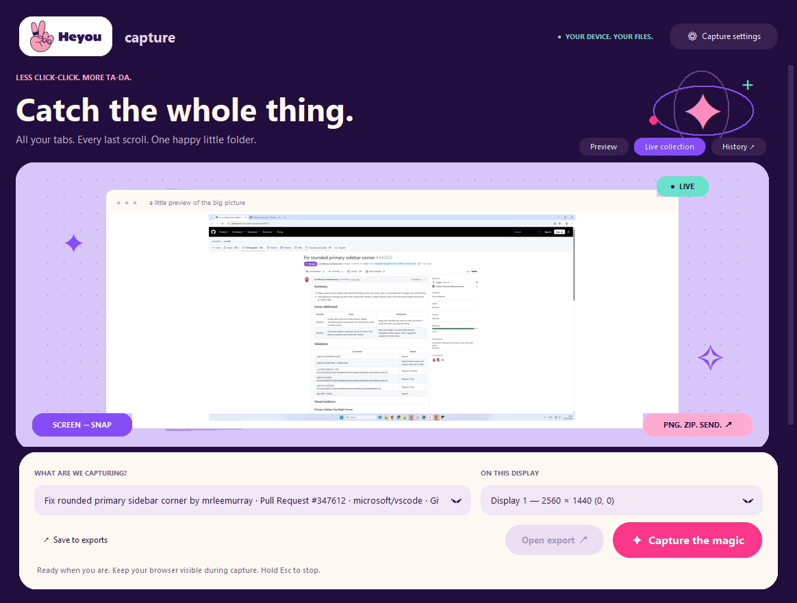

# Heyou Capture

**All your tabs. Every last scroll. One neatly organized collection.**

A local desktop tool for the repetitive screenshot work behind evidence gathering, reviews, and documentation. Pick a browser window: Heyou Capture visits its tabs, scrolls with overlap, and saves every page into its own URL-named folder. The real system clock remains in the full-display screenshots.

Built at Heyou while preparing approximately **500 screenshots** for SOC 2 evidence. This is a screenshot organizer, not an audit certification or a substitute for an auditor's evidence requirements.

## Download

[Get the latest release](https://github.com/heyouio/heyou-capture/releases).

[](https://github.com/heyouio/heyou-capture/releases/download/v0.1.0-beta.1/heyou-capture-demo.mp4)

The 25-second app-only demo captures two public VS Code pull requests: five screenshots, two folders. The approximately 500 screenshots above describe our evidence-gathering use case, not this demo run.

| Platform | Status | Browser support |
| --- | --- | --- |
| Windows 11 / x64 | Beta, tested locally | Chrome tested end to end; other Chromium browsers need validation |
| macOS / Apple Silicon | Experimental: testers needed | Google Chrome only in the first beta |
| macOS / Intel | Experimental: testers needed | Google Chrome only in the first beta |

Experimental Mac downloads for Apple Silicon and Intel are available in the release. Mac builds are not notarized. **A successful build is not proof of working screen capture on Mac hardware.** Please follow the [Mac tester guide](docs/MAC_TESTING.md) and report results with the issue template.

## What it does

- Captures every tab open in the selected window at the beginning of the run.
- Scrolls vertically with configurable overlap (15% by default).
- Keeps the actual Windows taskbar or macOS menu-bar clock in the display capture; no synthetic timestamp overlay.
- Creates one folder per tab, named from its URL, with only PNG files inside. The parent collection is ready to zip.
- Shows incoming folders and thumbnails in the live collection, with history and clearly labeled estimated time savings.
- Keeps screenshots and diagnostic records on your computer. No account, upload service, extension, or remote debugging port.

On Windows, live progress can move to a second display. On a single display—and in the initial Mac beta—the app hides during capture and reveals the finished collection afterward so it does not appear in your screenshots.

## Use it

1. Open the browser window containing the tabs you want. Keep its clock/date visible. On Mac, maximize normally rather than entering fullscreen, which can hide the menu bar.
2. Pick that window in the app. The display selection follows it. Or pick **Entire selected display** for one screenshot.
3. Choose your destination. **Capture settings** contains overlap, scroll delay, the enabled-by-default clock confirmation, and the manual-time estimate.
4. Start capture. Keep the browser visible and do not change its tabs. Hold Esc to stop.
5. Check the completion status before sharing. Open the export and zip the parent folder.

Time saved is an estimate: `images × manual seconds + folders × 15 − elapsed capture seconds`, clamped at zero. The default manual assumption is 30 seconds per image and can be changed. It is not a measured productivity claim.

## Run from source

Use Python 3.12 with Tk support.

```sh
python -m pip install -r requirements.txt
python app.py
```

Windows: `Build.cmd` creates the desktop executable. Mac: `python build_macos.py` creates an experimental `.app` and ZIP. GitHub Actions builds and runs portable checks on Windows, Apple Silicon, and Intel; [the initial build passed on all three](https://github.com/heyouio/heyou-capture/actions/runs/43035032192).

## Limits and privacy

The entire selected display is captured, including other visible content and notifications. Use a clean workspace for public demos. A URL may contain confidential query parameters; review folder names before sharing.

Complex nested scrolling, inaccessible controls, late-loading content, and infinite feeds need additional care. Runs stop at 500 images per tab and mark incomplete captures. A tab or URL change stops capture to avoid mixing pages. Diagnostic logs are outside export folders and include URLs and file paths: `%LOCALAPPDATA%/ScreenRecord/logs` on Windows, `~/Library/Application Support/Heyou Capture/logs` on Mac.

## Contribute

Mac testers are especially welcome. See [CONTRIBUTING.md](CONTRIBUTING.md), [the tester guide](docs/MAC_TESTING.md), and [open issues](https://github.com/heyouio/heyou-capture/issues). Do not attach private screenshots, access tokens, or confidential URLs to public issues.

MIT licensed. Heyou name and logo remain Heyou trademarks; the code license does not imply endorsement of forks.
